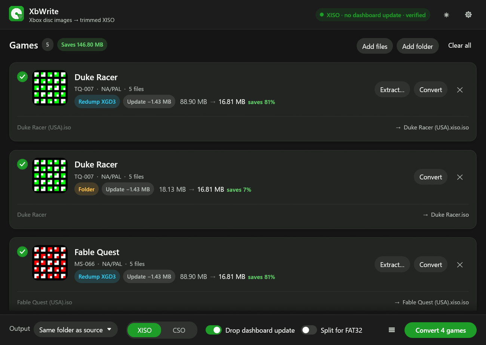

# XbWrite

XbWrite turns original Xbox disc images into trimmed XISO images. It is a desktop app for
Windows, Linux and macOS, written in Rust, and a sibling of Cartwrite.

A full Redump-style dump of an Xbox disc is mostly padding. It carries the DVD video partition
in front of the game and the random filler the pressing plant put between files. The game itself
only needs its XDVDFS file system, so XbWrite rebuilds the image from the files alone. A Redump
image is 7–8 GB whatever the game; the XISO is only as big as the game's files, and plays the
same in xemu or on a modded console.

The image building is done by [xdvdfs](https://github.com/antangelo/xdvdfs), whose core crate
XbWrite uses straight from the `xdvdfs/` checkout in this folder.



## Features

- Reads Redump ISOs (XGD1, XGD2 and XGD3), existing XISOs, CSOs, split images (`.1.iso`,
  `.2.iso`, …) and extracted game folders (anything with a `default.xbe`).
- Shows each game's title, title ID, region and title image straight from its `default.xbe`,
  and the exact size of the XISO before you convert.
- Can leave out the `$SystemUpdate` dashboard update folder, which only an unmodified console
  on an old dashboard ever installs. On by default.
- Writes a plain XISO (for xemu, Cerbios, Stellar, XBMC4Gamers, burning) or an LZ4-compressed
  CSO (for the console loaders that read it).
- Can split images over 4 GB into `.1.iso`, `.2.iso`, … parts for FAT32 drives.
- Verifies each new image by reading it back and comparing every file with the source. On by
  default.
- Can replace the original image once the new one is written and verified.
- Can extract a game's files to a folder.
- A cancelled or failed conversion leaves nothing behind: output goes to `.part` files that are
  only renamed into place at the end.
- Dark and light themes.

## Getting the app

Download the package for your system from the Releases page:

- **Windows:** `XbWrite-<version>-windows-x64.zip`. Extract it anywhere and run `xbwrite.exe`.
- **Linux:** `XbWrite-<version>-linux-x64.tar.gz`. Extract it and run `./xbwrite`. It needs an
  X11 or Wayland desktop, and its file dialogs use the XDG desktop portal.
- **macOS:** `XbWrite-<version>-macos-universal.tar.gz`, for Apple silicon and Intel Macs.
  Extract it and open `XbWrite.app`. The app isn't signed by Apple, so the first time,
  right-click it and choose **Open**.

## Using XbWrite

1. Drag images or folders onto the window, or use **Add files** / **Add folder**. A folder that
   isn't a game itself is searched for images and game folders.
2. Check the cards: each shows the source type (for example **Redump XGD2**), the size now and
   after converting, and where the new image will go.
3. Pick **XISO** or **CSO** at the bottom, then click **Convert** on a card, or the green button
   to convert every selected game.

The new image is written next to its source unless you choose an output folder. When that
would overwrite the source, it is named `<name>.xiso.iso` instead, unless **Replace the original
image** is on in Settings.

An XISO that converting wouldn't make any smaller is marked **Already trimmed** and isn't
selected by default.

### Settings

| Setting | Default | What it does |
| - | - | - |
| Drop the dashboard update | on | Leaves out `$SystemUpdate`. |
| Split for FAT32 | off | Cuts images over 4 GB (at `0xFFBF6000` bytes, like xdvdfs) into numbered parts. |
| Verify after writing | on | Reads the new image back and compares every file with the source. |
| Replace the original image | off | Deletes the source image after a successful conversion. Game folders are never deleted. |

## Command line

`xbwrite-cli` does the same from a terminal:

```
xbwrite-cli info <images/folders...>
xbwrite-cli convert [-o DIR] [--cso] [--split] [--keep-update] [--no-verify] [--replace] <images/folders...>
xbwrite-cli extract [-o DIR] [--keep-update] [--overwrite] <images...>
```

`convert` drops the dashboard update and verifies by default, like the app.

## Building from source

Needs a recent stable Rust toolchain. [xdvdfs](https://github.com/antangelo/xdvdfs) is a git
submodule in `xdvdfs/`; XbWrite builds its `xdvdfs-core` crate with the `sync` feature. Clone
with submodules:

```
git clone --recurse-submodules <repository url>
cargo build --release
```

In an existing clone, `git submodule update --init` fetches xdvdfs.

Format with `cargo fmt`, not `cargo fmt --all`: `--all` also reformats path dependencies, which
would rewrite the xdvdfs checkout with this project's style.

This produces `target/release/xbwrite` (the app) and `target/release/xbwrite-cli`.

The workspace has three crates:

- `crates/xbwrite-core`: scanning, XBE and title image parsing, conversion, verification and
  extraction. Tests build small fake games and Redump-style images in a temp folder.
- `crates/xbwrite`: the egui desktop app.
- `crates/xbwrite-cli`: the command line front end.

For UI work, `XBWRITE_SCREENSHOT=out.png` saves a screenshot after about two seconds and exits,
`XBWRITE_DEBUG_THEME=light` forces the light theme, `XBWRITE_DEBUG_SETTINGS` opens Settings and
`XBWRITE_DEBUG_CONVERT` starts converting the selected games once they're read.

## Releases

Pushing a `v*` tag runs `.github/workflows/release.yml`, which tests and builds XbWrite on
Windows, Linux and macOS (universal binaries), packages each with `packaging/package.py` and
attaches the packages to a draft GitHub release of that tag. Bump `version` in the workspace
`Cargo.toml` before tagging.

## License

MIT, like xdvdfs. See `LICENSE`; release packages also include xdvdfs's license.
